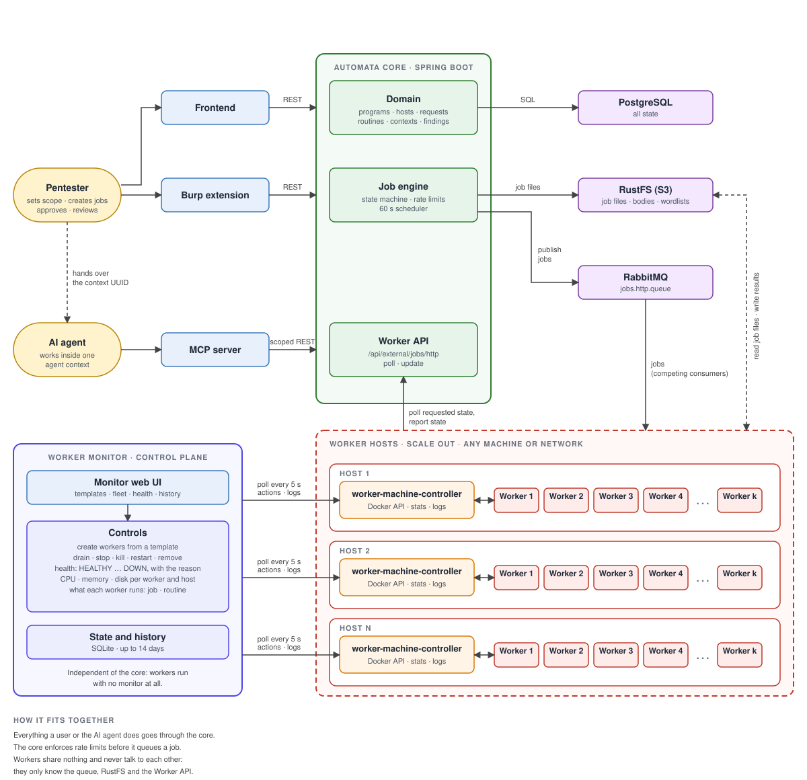

# Automata

A framework for automating security testing of HTTP APIs. It stores the attack surface (programs, hosts, tenants, requests and responses parsed down to the parameter), runs testing tools against it as rate-governed **jobs** executed by distributed workers, and lets an **AI agent** do the repetitive testing inside limits a human sets, with a human approving what matters and reviewing every finding.

Status: working end to end on a developer machine (core, frontend, MCP server under `docker compose`; the Go worker runs from its own repo). It has **no authentication** and is not meant to be exposed to a network yet.

---

## Repositories

| Repo | Role | Stack |
|---|---|---|
| `automata` (this one, `code/automata`) | Core service: REST API, domain, job engine, scheduling. Also holds the compose file for the stack | Spring Boot 3.5, Java 21 |
| `automata-frontend` | UI for programs, hosts, requests, jobs, findings, agent contexts | React + TypeScript |
| `automata-worker` | Orchestrator that consumes queued jobs, plus the tool connectors (`ffuf`, `masser`) | Go |
| `automata-mcp` | MCP server the AI agent talks to; translates tool calls into core REST calls, holds no business logic | Python, official `mcp` SDK |
| Burp extension | Sends proxy traffic to the core | |

Core and worker only talk through a documented contract (`code/automata/docs/worker-contract.md`, checked by tests on both sides). Core and MCP server only talk through the agent-facing routes (`/api/agent-contexts/uuid/{uuid}/...`).

---

## Architecture



| Box | What it is |
|---|---|
| Pentester | Defines scope and limits, creates and queues jobs, approves AI jobs, pauses or cancels, reviews findings |
| AI agent | Tests within one agent context, reaches the core only through the MCP server |
| Domain | Programs, hosts, tenants, requests, equality sets, routines, wordlists, agent contexts, findings |
| Job engine | State machine, rate governance, 60 s scheduler that publishes to RabbitMQ |
| Worker API | `/api/external/jobs/http`: workers poll the requested state and report state changes |
| RabbitMQ | `jobs.http.queue`, carries `{jobId, routineKey}`, consumed competitively |
| RustFS | Job configuration and results, request/response bodies, wordlists |
| Orchestrator | Runs the ffuf and masser connectors, on any machine or network |

- **PostgreSQL**: all state. The schema is owned by Flyway migrations; Hibernate only validates it.
- **RabbitMQ**: one queue (`jobs.http.queue`) carrying `{jobId, routineKey}`; the job data is in object storage.
- **RustFS (S3-compatible)**: buckets for job configuration, job results, request/response bodies and wordlists.
- The core never runs a tool. Workers poll the core for a requested state (pause, resume, cancel) and report state changes back.

---

## How a test runs

Automata splits the work between a person and an AI agent, and between the core and a fleet of workers. The person decides, the agent does the legwork, the core enforces the rules, the workers do the traffic.

| Step | Who | What happens |
|---|---|---|
| 1. Set the scene | **Pentester** | Creates the program, its hosts (with their rate limits), tenants (the identities to test as) and loads the attack surface: Burp traffic, manual entry, wordlists. Requests can be grouped into equality sets. |
| 2. Hand over a scope | **Pentester** | Creates an **agent context**: one host, the requests or equality sets the agent may look at, the tenants it may use, the routines it may run, a maximum rate, defaults, and whether jobs of each item are auto-approved. The context has a UUID, which the pentester gives to the agent. |
| 3. Investigate | **AI agent** | Reads only what is in its context (anything else is a 404): requests, responses, host notes, tenants, the history of earlier jobs. It decides what is worth testing and can add requests it discovers. |
| 4. Propose jobs | **AI agent** | Creates a job on a request with a routine (for example `fuzz`), a description of what the result would prove (`aiDescription`) and optionally a rate. The core applies the same rules as for a person and refuses anything above the limits. The job is a `DRAFT`. |
| 5. Approve | **Pentester** | A job whose item is auto-approved goes ahead. Any other AI job waits as *waiting for action* until the pentester approves it, and it cannot be queued before that. |
| 6. Queue and run | **Pentester or agent**, **core**, **workers** | Someone queues the approved job (it moves to `TOQUEUE`). The core's scheduler checks program and host rate limits and publishes it. The next worker that is free takes it, runs the tool and reports back (see [Distributed workers](#distributed-workers)). |
| 7. Supervise | **Pentester** | Can pause, resume or cancel any job at any moment, including the agent's. |
| 8. Review results | **AI agent** | Waits for its jobs to end (the MCP tool `wait_for_jobs` returns when one ends, or when the rest are waiting for a human), reads the result and writes a summary (`aiResult`). It can also look at the jobs that earlier targeted the same request, whoever created them. |
| 9. Report | **AI agent**, **Pentester** | The agent records a finding with severity, confidence and, to confirm it, the steps to reproduce. The pentester gives the verdict (true or false positive). The agent can no longer change a finding once a human has ruled on it. |
| 10. Repeat | both | The agent picks the next idea, the pentester widens or narrows the context. |

### Human in the loop

The agent is useful because it is fast, and safe because it is boxed in. The limits are enforced by the core, not by the agent's good behaviour, and the core has no authentication of its own, so the scoping is done by the context-scoped routes and the MCP tool list.

- **Scope**: the agent sees and acts on a single host and the requests the pentester put in its context. Anything outside answers 404.
- **Approval gate**: an AI job is queued only if it is approved, either automatically by the context (per item, the most restrictive rule wins) or by the pentester.
- **Hard limits**: rate caps (the context's `maxRate`, the host and program limits), allowed routines and tenants, and priority range apply to every job, whoever creates it.
- **Reserved to the human**: pause, resume, approve, create jobs as a user, and review findings. The agent can only cancel its own jobs.
- **Visibility**: every job records who created it (`USER` or `AI`), its context, its description and its result, so a person can always see what the agent did and why.
- **Isolation**: what the agent reads about other jobs or findings never carries the id of another context.

---

## Domain model

**Program → Host → Tenant / Request → Response**

- **Program**: an engagement (bug bounty or pentest), with a program-wide rate limit and out-of-scope vulnerabilities.
- **Host**: an FQDN or wildcard (a name needs a dot; `level` is the number of labels below the registrable domain). It has a description, technologies and notes (read by the AI) and three limits: `hostRateLimit`, `shortRateLimit`, `longRateLimit` (`host >= short + long`). A host with limit 0 is closed to jobs.
- **Tenant**: an authenticated identity on a host with static authentication data (headers, cookies, query parameters). Dynamic token generation was removed.
- **Request / Response**: any content type is accepted. The head is parsed into method, path, version, extension, headers, query parameters and path variables; JSON and form bodies (and JSON responses) are flattened to one row per property. The raw message is kept; multipart request bodies and non-JSON response bodies are stored as files in object storage. A request has at most one response. Sources: `MANUAL`, `BURP`, `WAYBACK`, `AI`. Bodies are read through `metadata`, `raw` and `body/stream` routes.
- **Equality sets and comparators**: requests of a host are grouped into `RequestEqualitySet`s by a `Comparator` made of `Modifier`s (method, path, query string, body, hashed with murmur3). This area is still being refactored (the body hash strategy is known to be broken). Equality sets are **not** job targets; they group requests and serve as items of an agent context.
- **Routine**: a reusable playbook. A unique `key` maps to a worker connector, plus overhead, protocol, allowed target cardinalities, a JSON `configSchema` that validates a job's `customConfig`, whether a wordlist is required, and the result content type.
- **Vulnerability**: a hierarchical taxonomy. **Wordlist**: an immutable uploaded file (sha256, size, line count) in a private bucket; workers download and cache it by hash.
- **Finding**: a vulnerability finding with CVSS severity, confidence, `SUGGESTED`/`CONFIRMED` status, PoC steps (required to confirm) and a human verdict (`TRUE_POSITIVE`/`FALSE_POSITIVE`).

---

## Jobs

An `HttpJob` is either a **`NarrowHttpJob`** (one host; targets a single request, several requests or the host; has a `SHORT`/`LONG` duration and an optional tenant) or a **`WideHttpJob`** (several hosts of one program). Scope is derived from the target. There is no cross-program scope.

Every creation path (user narrow, user wide, AI) applies the same rules: rate at least 1 and within the program, host and duration limits, priority 1-5, `customConfig` valid against the routine's schema, routine available and accepting the target cardinality, and the tenant must belong to the host. A job is created as `DRAFT`.

### States

`DRAFT → TOQUEUE → QUEUED → RUNNING ⇄ PAUSED → FINISHED | FAILED | SELFTERMINATED | CANCELED | LOSTCONTACT`

- The core owns the state machine. `SCHEDULED` exists as a state, but scheduling a job for later is not implemented (the route is disabled).
- Queueing is an explicit step (`DRAFT → TOQUEUE`), done by the pentester or, for an AI job, by the agent; approving a job does not queue it.
- A scheduled task (every 60 s, `SERIALIZABLE`) sorts `TOQUEUE` jobs by priority, enforces program and host rate limits, publishes to RabbitMQ and marks them `QUEUED`.
- Pause, resume and cancel are *requested* states that the worker picks up by polling; a cancel replaces a pending pause or resume, and a pause or resume is refused while a cancel is pending.
- `SELFTERMINATED` is what a worker reports when it ends a job itself. `LOSTCONTACT` is set only by the core, when a running or paused job has had no worker contact for 30 minutes.
- A failed job carries a `failureCategory` and a `failureMessage`. Job DTOs expose `terminal` and `waitingForAction`, so clients do not copy the rules.

### Distributed workers

The core never runs a tool. The tools run in a fleet of independent **orchestrators** (Go, `automata-worker`) that you start wherever you need them: on one laptop, on several servers, or near the targets in different networks. They need only three things: the queue, the object storage and the core's worker API.

- **Competing consumers**: all orchestrators read the same queue (`jobs.http.queue`); each job goes to one of them, whichever is free first. More orchestrators mean more jobs in parallel, with no change to the core.
- **Nothing shared**: an orchestrator never talks to another one. It reads `details/{jobId}.json` and `data/{jobId}.jsonl`, downloads the wordlists it needs into its own cache (by sha256, least recently used removed above 1.5 GB by default), runs the connector of the routine (`fuzz` → ffuf, `masser` → masser) and writes `{jobId}.result`.
- **Rate limits stay global**: the core checks the program and host limits before it queues a job, so adding workers cannot make the fleet exceed them.
- **Remote control**: pause, resume and cancel are requests the core keeps; each orchestrator polls for them and reports its state changes. A person controls a job on a machine the core cannot reach directly (the agent can only cancel its own jobs).
- **Failures are visible**: a worker that ends a job reports `SELFTERMINATED` or `FAILED` with a category and a message, and a running job whose worker has been silent for 30 minutes is marked `LOSTCONTACT` by the core.
- **Extensible**: a new tool is a new connector plus a routine whose `key` is in the worker's mapping file; the core only validates the job's `customConfig` against the routine's schema.

---

## AI agent

The agent never talks to the core directly. It uses the MCP server (38 tools, a workflow prompt, two resources), which only translates tool calls into the core's context-scoped REST routes and holds no business logic. What it can do:

- **Read** (inside its context): resolved requests, the host, the tenants with their static auth data, request and response metadata, raw messages and bodies, and the read-only job history of a request.
- **Add**: requests it discovers (with a response, optionally for a tenant of its context) and wordlists.
- **Act on its own jobs**: create, queue, retry the preparation of, cancel, and write the description and the result.
- **Report**: create findings and edit the ones it created until a human rules on them.

What it cannot do is listed under [Human in the loop](#human-in-the-loop).

---

## Request ingestion

1. **Burp Suite extension** posts raw requests (and optionally responses) to the Burp integration route.
2. **UI / API**: manual entry.
3. **AI agent**: `POST /api/external/ai/requests`, by host name.

---

## Getting started

Prerequisites: Docker and Docker Compose; Java 21 only if you run the core outside Docker. The frontend and MCP server repos are expected at the paths in `docker-compose.yml`. The worker is built and run from the `automata-worker` repo and pointed at the same RabbitMQ, RustFS and core.

```bash
cd code/automata
docker compose up --build -d     # postgres, rabbitmq, rustfs, core, frontend, MCP server
docker compose down              # stop; add -v to also drop the data
```

- Core API `http://localhost:8080` (OpenAPI UI via springdoc)
- MCP server (streamable HTTP) `http://127.0.0.1:8000/mcp`
- RabbitMQ management `http://localhost:15672`, RustFS console `http://localhost:9001` (credentials in `docker-compose.yml`)

To run only the core: start the backing services (`docker compose up -d postgres rabbitmq rustfs rustfs-init`), set the environment variables listed in `code/automata/.claude/CLAUDE.md` and run `./mvnw spring-boot:run`. Tests: `./mvnw test`. If an old dev volume refuses to start (tables without Flyway history), recreate it with `docker compose down -v`.

`scripts/import-wordlists.sh` uploads a directory of existing wordlists.

---

## Where this is going

Automata is meant to become the operational backbone of a pentester's workflow, with an AI agent doing the repetitive testing under human supervision: the person defines the scope and the limits, approves what needs approving and reviews the findings, and the agent plans jobs, reads their results and reports. The core keeps the rules (rate governance, scoping, approval) so that neither the agent nor the workers have to be trusted with them, and workers stay loosely coupled so that more tools and more instances can be added without changing the core.
